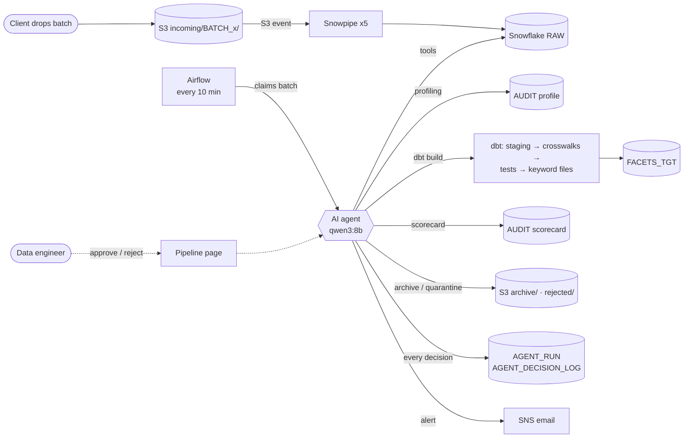
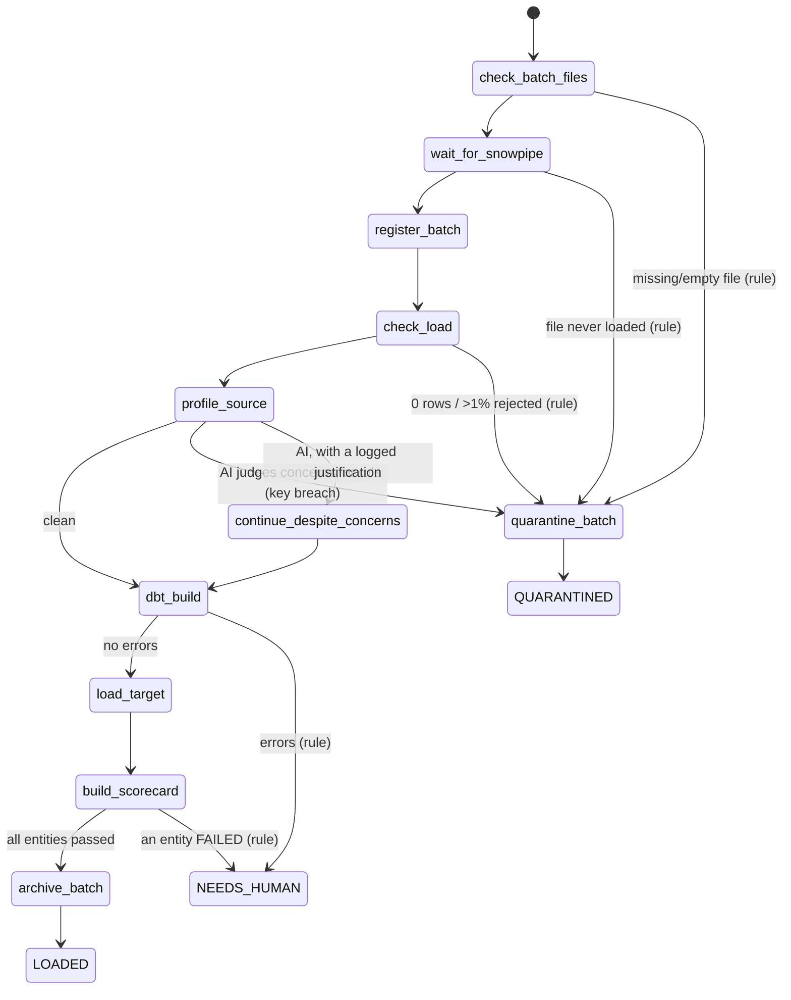

# HC Pipeline — AI-agent data migration pipeline (AWS · Snowflake · dbt · Airflow · local LLM)

A healthcare payer data migration (legacy extracts → Facets-like target) run end to end by an
**AI agent**: files land in **AWS S3**, **Snowpipe** loads them, **Airflow** hands each batch to a
**qwen3:8b agent** (running locally, free) that decides step by step — profile, quarantine or
continue, **dbt** build, load target, reconcile, archive — and explains every decision.
Everything runs on free tiers: AWS Free plan, Snowflake trial, Ollama, Airflow on a laptop.

**Contents:** [The problem](#the-problem-it-solves) · [Big picture](#big-picture) · [The pieces](#the-pieces) ·
[Where data lives](#where-the-data-lives) · [Journey of one batch](#the-journey-of-one-batch-start-to-finish) ·
[Inside the agent](#inside-the-agent) · [When things go wrong](#when-things-go-wrong) ·
[Where to look](#where-to-look-while-it-runs) · [Demo](#demo-in-5-minutes) · [Setup](#setup-from-scratch) ·
[Run it](#run-it) · [Tests](#tests) · [Design decisions](#design-decisions) · [Lessons](#lessons-what-went-wrong-and-how-it-was-fixed)

---

## The problem it solves

On a real payer conversion (legacy system → Facets), the client sends extracts in **batches**. For each batch a
migration developer runs the same chain by hand: load the files, profile them, decide whether the data is good
enough, transform it with the mapping rules, validate, load the target, build the reconciliation scorecard, and
tell everyone what happened. Most batches are routine; a few are broken (a missing file, a column full of bad
IDs) and must be stopped **before** they reach the target.

This project automates that chain:

- **Loading** is event-driven — a file dropped in S3 is in Snowflake within about a minute (Snowpipe).
- **Every other step** is run by an **AI agent** that picks the next step, says why, and writes a summary.
- **Safety** does not depend on the AI: measurable rules (0 rows, missing file, bad key column) are enforced by
  code that the agent cannot override. When in doubt the batch is **quarantined** (reversible), never loaded.
- **Human mode**: the agent can ask for approval before every single action.
- **Everything is logged** in Snowflake: each run, each step, the agent's reason, the result.

The transformation itself (dbt models, stored procedures, scorecard) is the separate migration project
[snowflake-healthcare-data-migration](https://github.com/Lavanya-developer0309/snowflake-healthcare-data-migration);
this repo is the automation and the agent around it.

## Big picture



Two things happen **independently**:
1. **Loading** (left): S3 → Snowpipe → RAW. Runs inside AWS and Snowflake the moment a file arrives — no laptop needed.
2. **Processing** (right): Airflow → agent → everything else. Runs on the laptop every 10 minutes.

The agent's first steps check that loading really finished before it goes on.

## The pieces

| Piece | What it does here | Where it runs | Cost |
|---|---|---|---|
| **AWS S3** | Landing bucket. Folders `incoming/`, `archive/`, `rejected/` | AWS Sydney | Free plan |
| **S3 event notification** | Tells Snowpipe "a new `.txt` file arrived in `incoming/`" (via Snowflake's SQS queue) | AWS | Free |
| **Snowpipe** (5 pipes) | Loads each file into its RAW table automatically; batch id taken from the folder name | Snowflake | Trial credits |
| **Snowflake** | RAW, AUDIT, dbt layers, target tables, stored procedures, agent logs | Snowflake (AWS Sydney) | Trial credits |
| **dbt Core** | Cleanses, applies mapping rules, tests, writes keyword (load) files | Laptop → Snowflake | Free |
| **Apache Airflow 3** | Every 10 min: is there a new batch? claim it, start the agent | Laptop (`./run_airflow.sh`) | Free |
| **Ollama + qwen3:8b** | The AI model behind the agent; tool calling, temperature 0 | Laptop | Free, data never leaves the Mac |
| **Agent** (`agent/`) | Loop: ask the model → guard checks the choice → run tool → log → repeat | Laptop, inside Airflow task | Free |
| **AWS SNS** | Email when a run finishes or an approval is needed | AWS | Free tier (1,000 emails/month) |
| **Pipeline page** | Web page: runs, decisions, approve/reject buttons | Laptop ([ai-data-profiling-agent](https://github.com/Lavanya-developer0309/ai-data-profiling-agent)) | Free |

## Where the data lives

**S3 bucket**
```
incoming/BATCH_007/SRC_GROUP.txt …        ← client uploads here; Snowpipe watches this prefix
incoming/BATCH_007/_PROCESSING            ← lock written by the Airflow run that took the batch
archive/BATCH_007/…                       ← batch LOADED: files moved here
rejected/BATCH_004/… + _REASON.txt        ← batch QUARANTINED: files moved here with the reason
```

**Snowflake** — database `HC_MIGRATION_DB`

| Schema | What is in it | Filled by |
|---|---|---|
| `RAW` | `SRC_GROUP`, `SRC_MEMBER`, `SRC_PROVIDER`, `SRC_CLAIM_HEADER`, `SRC_CLAIM_LINE` — all VARCHAR, plus `BATCH_ID`, file name, row number, load time. Stage `STG_S3_LANDING`, pipes `PIPE_SRC_*` | Snowpipe |
| `AUDIT` | Config (`MIG_SOURCE_FILE_CONFIG`), batch control, load log, profiling results, scorecard, stored procedures, **agent logs** (`AGENT_RUN`, `AGENT_DECISION_LOG`, view `V_AGENT_RUNS`) | Procedures + agent |
| `STAGING`, `INTERMEDIATE`, `REF` | dbt views/tables: cleansed data, mapping rules, crosswalk seeds | dbt |
| `FACETS_STG`, `KEYWORD` | Facets-like tables (`CMC_MEME_MEMBER`, `CMC_CLCL_CLAIM`…) and the keyword (load) files | dbt |
| `FACETS_TGT` | The target system | `SP_LOAD_FACETS_TARGET` |

The five expected files per batch come from `AUDIT.MIG_SOURCE_FILE_CONFIG` — nothing is hard-coded.

---

## The journey of one batch, start to finish

A real run: **BATCH_007** (5 files, 28,310 source rows), processed on 2026-10-22 in **344 seconds**, result **LOADED**.

### Stage 0 — the client drops files (≈ 10 s)
Five pipe-delimited files are uploaded to `s3://<bucket>/incoming/BATCH_007/`. The folder name **is** the batch id.

### Stage 1 — Snowpipe loads RAW (≈ 1 min, automatic)
- S3 sends an "object created" event for each `.txt` file to Snowflake's SQS queue (`aws/s3_notification.json`).
- The matching pipe (`snowflake/03_snowpipes.sql`) runs a `COPY INTO RAW.SRC_x` for that one file:
  `BATCH_ID = SPLIT_PART(METADATA$FILENAME, '/', 2)` → `BATCH_007`.
- `ON_ERROR = CONTINUE`: a bad row is skipped and counted, not fatal. All columns are VARCHAR, so a bad date
  never breaks the load — bad values are judged later by profiling and dbt.
- Snowpipe never loads the same file twice.

### Stage 2 — Airflow finds and claims the batch (every 10 min)
DAG `hc_agent_pipeline` (`dags/hc_agent_pipeline.py`) has two tasks:
- **`find_batch`** lists `incoming/` in S3 (S3 only — no Snowflake warehouse is woken up, so checking every 10
  minutes costs nothing). A batch is *ready* when all expected files are there, or when no new file arrived for
  30 minutes (then the missing file is reported by the agent's first check).
  It **claims** the batch by writing `_PROCESSING` with an S3 conditional write (`IfNoneMatch="*"`): if two runs
  try at once, only one succeeds. Nothing to do → the next task is *skipped* (pink in Airflow).
- **`run_agent`** calls `agent.runner.run("BATCH_007")`. `LOADED` / `QUARANTINED` = green task; `NEEDS_HUMAN` =
  red task, so it gets attention.

### Stage 3 — the agent works through the batch
The agent is a loop (`agent/runner.py`): show the model the tools that are allowed **right now** → the model picks
one and gives a reason → the guard checks it → the tool runs → the short result goes back to the model → logged.

What BATCH_007's agent actually did (from `AUDIT.AGENT_DECISION_LOG`):

| # | Tool | What it does | Result for BATCH_007 | Time |
|---|---|---|---|---|
| 1 | `check_batch_files` | All 5 expected files in S3, none empty? *(hard rule)* | 5 of 5 found | 15 s |
| 2 | `wait_for_snowpipe` | Polls `COPY_HISTORY` until every file is loaded; after 2 min runs `ALTER PIPE … REFRESH` once; gives up after 10 min | all 5 `Loaded`, 0 rejected | 16 s |
| 3 | `register_batch` | `SP_REGISTER_S3_BATCH`: batch control → RUNNING, row counts → `MIG_LOAD_LOG` | GROUP 60 · MEMBER 3,938 · PROVIDER 350 · CLAIM_HEADER 8,000 · CLAIM_LINE 15,962 | 13 s |
| 4 | `check_load` | Every file has rows; Snowpipe rejected ≤ 1 %; every row has the header's column count *(hard rules)* | ok | 15 s |
| 5 | `profile_source` | `SP_PROFILE_ALL` profiles every column (nulls, lengths, invalid characters, bad dates…); code classifies the results | 65 columns: 0 breaches, 0 concerns, 10 minor issues, 5 optional columns empty | 48 s |
| 6 | `dbt_build` | `dbt build --vars {batch_id}`: staging → mapping rules → Facets-like tables → tests → keyword files | 31 models ok, 73 tests pass, 13 warnings, 0 errors | 105 s |
| 7 | `load_target` | `SP_LOAD_FACETS_TARGET`: header/trailer checks, transactional load into `FACETS_TGT` | 7 entities loaded | 55 s |
| 8 | `build_scorecard` | `SP_BUILD_SCORECARD`: source vs rejected vs loaded per entity | all BALANCED / MATCH | 49 s |
| 9 | `archive_batch` | Move files `incoming/` → `archive/` | 6 files moved | 15 s |
| 10 | `finish_run` | Final status + summary for the engineer; numbers checked against tool results | **LOADED** | 14 s |

Each row's **reason** is the model's own words, e.g. step 9: *"I need to archive BATCH_007 since all entities
passed the reconciliation scorecard and the batch is successfully loaded into FACETS_TGT."*

### Stage 4 — the scorecard (what "loaded" means)

| Entity | Source | Rejected (with reason) | Loaded | Status |
|---|---:|---:|---:|---|
| GROUP | 60 | 0 | 60 | PASSED |
| SUBSCRIBER | 1,505 | 9 | 1,496 | PASSED_WITH_WARNINGS |
| MEMBER | 3,938 | 36 | 3,902 | PASSED_WITH_WARNINGS |
| ELIGIBILITY | 3,938 | 36 | 3,902 | PASSED_WITH_WARNINGS |
| PROVIDER | 350 | 3 | 347 | PASSED_WITH_WARNINGS |
| CLAIM | 8,000 | 125 | 7,875 | PASSED_WITH_WARNINGS |
| CLAIM_LINE | 15,962 | 240 | 15,722 | PASSED_WITH_WARNINGS |

*Source = Rejected + Loaded* for every entity ("BALANCED"), and the target holds exactly what the keyword files
said ("MATCH"). Rejected rows are not lost: they sit in `FACETS_STG.MIG_TRANSFORM_REJECTS` with the reason
(bad SSN, unknown gender code, member whose subscriber was rejected…). The same files loaded as BATCH_002, 003,
005, 006 and 007 give an identical scorecard every time.

### Stage 5 — the agent finishes
- `AUDIT.AGENT_RUN` gets the final status, number of steps and the summary.
- An SNS email goes out: status, summary, and what to do next.
- Airflow marks `run_agent` green. The lock file moved to `archive/` with the batch.

The summary BATCH_007's agent wrote:
> BATCH_007 was successfully processed. All files were loaded into the RAW layer with 0 rejected rows. The dbt
> build completed with 31 successes, 13 warnings, and 73 passes. The load into FACETS_TGT was successful with the
> following load percentages: CLAIM (98.44%), CLAIM_LINE (98.5%), ELIGIBILITY (99.09%), GROUP (100.0%),
> MEMBER (99.09%), PROVIDER (99.14%), and SUBSCRIBER (99.4%). The batch has been archived.

---

## Inside the agent

### The loop
```
messages = [system prompt (the rules), "New batch BATCH_007 arrived. Process it."]
repeat (max 25 steps):
    model sees ONLY the tools the guard allows now  →  picks one + a reason
    guard.check()   → blocked? tell the model why and what IS allowed, continue
    human mode?     → wait for approve / reject
    run the tool    → short result (small models lose track of long JSON)
    guard.record()  → update state; hard rules may force quarantine or hand over
    log the step in AUDIT.AGENT_DECISION_LOG
until finish_run
```
If the model answers in text instead of calling a tool it is nudged (max 3 times), then the run ends `NEEDS_HUMAN`.
A tool that crashes is reported back to the model as an error, not fatal; the same tool failing twice → `NEEDS_HUMAN`.

### The guard — which step may come next
The guard (`agent/tools.py`) is a small state machine. The model can only choose among the arrows leaving the
current step, so it can never skip validation or load before profiling.


Before the target is loaded the agent may also stop at any point with `finish_run(NEEDS_HUMAN)`.
`LOADED` is only accepted after `archive_batch`; `QUARANTINED` only after `quarantine_batch`.

### Rules vs AI
Testing showed an 8B model will happily load a batch with 40 % missing member ids ("the data looks mostly fine").
So **everything measurable is a rule** the guard enforces; the AI orders the work, judges what rules can't, and explains:

| Situation | Decided by |
|---|---|
| Missing/empty file, 0 rows loaded, > 1 % rows rejected by Snowpipe | rule → quarantine |
| Any row with a different number of columns than the file header (e.g. an unescaped `\|` in a name) | rule → quarantine |
| Key column (ids) > 1 % bad, or critical column (DOB, SSN, gender, member names, claim dates/amounts/codes) > 20 % bad | rule → quarantine |
| Any other column > 20 % bad | **agent** — quarantine, or continue with a logged justification |
| Empty optional columns (middle initial, modifiers, org vs person names…) | rule → ignored |
| dbt errors · an entity FAILED reconciliation · a human said no · a tool failed twice | rule → only `NEEDS_HUMAN` |
| Step order, when to stop, the summary for the engineer | **agent** (numbers in the summary are checked against tool results) |

The profiling result is **classified by code before the model sees it** (`summarise_profile`): the model gets
`key_column_breaches`, `concerns`, `optional_columns`, `minor_issues` — never raw percentages to compare itself.

### No invented numbers
Every number in the final summary must appear in some tool result. If the model writes a number that does not
(a miscalculated total, a made-up percentage) the summary is sent back once; if it happens again, code replaces it
with a plain factual summary and marks `summary_replaced: true` in the log.

### Human mode
`APPROVAL_MODE=human` in `.env` (or `--mode human`): before **every** tool the agent writes an approval request to
`state/approvals.db` (SQLite — waiting costs nothing), sends an email, and waits. Approve or reject on the
Pipeline page or with `python -m agent.approvals <id> yes|no "note"`. A rejection ends the run as `NEEDS_HUMAN`
with the note. BATCH_006 was run this way: 9 approvals, LOADED.

### The 12 tools
| Tool | Calls | Rule? |
|---|---|---|
| `check_batch_files` | S3 list vs `MIG_SOURCE_FILE_CONFIG` | hard rule |
| `wait_for_snowpipe` | `COPY_HISTORY`, `ALTER PIPE … REFRESH` | hard rule |
| `register_batch` | `AUDIT.SP_REGISTER_S3_BATCH` | |
| `check_load` | row counts + Snowpipe rejects | hard rule |
| `profile_source` | `AUDIT.SP_PROFILE_ALL` + `V_DQ_PROFILE_REPORT`, classified by code | key breaches = rule |
| `continue_despite_concerns` | nothing — records the agent's justification | |
| `dbt_build` | `dbt run-operation clear_keyword_files` + `dbt build`, reads `run_results.json` | errors = rule |
| `load_target` | `AUDIT.SP_LOAD_FACETS_TARGET` | |
| `build_scorecard` | `AUDIT.SP_BUILD_SCORECARD` + `V_SCORECARD` | FAILED = rule |
| `archive_batch` | S3 move `incoming/` → `archive/` | |
| `quarantine_batch` | S3 move → `rejected/` + `_REASON.txt`, deletes the batch's RAW rows | |
| `finish_run` | ends the run: `LOADED` / `QUARANTINED` / `NEEDS_HUMAN` + summary | status checked |

Every tool is a plain function in `pipeline/steps.py`; the agent's tools in `agent/tools.py` are thin wrappers that
shorten the results.

---

## When things go wrong

| What happens | What the pipeline does | Result | What you do |
|---|---|---|---|
| A file is missing or empty | `check_batch_files` fails → rule forces quarantine | QUARANTINED, files in `rejected/` with `_REASON.txt` | Ask the client for the file; upload as a new batch |
| Snowpipe missed the S3 event | `wait_for_snowpipe` refreshes the pipe after 2 min | continues normally | nothing |
| File loaded 0 rows (wrong format/name) | `check_load` fails → quarantine | QUARANTINED | fix the file |
| A row has an extra `\|` (columns shifted) | `check_load` counts fields per line → quarantine | QUARANTINED (BATCH_011: 97 s) | ask the client for a corrected file |
| Member ids 40 % blank | profiling → key column breach → quarantine (the AI cannot continue) | QUARANTINED | ask the client |
| A non-key column > 20 % bad | agent decides: quarantine, or continue with a justification per column | either; justification logged | review the justification |
| dbt errors | guard leaves only `finish_run(NEEDS_HUMAN)` | NEEDS_HUMAN, Airflow task red, batch stays locked in `incoming/` | fix, then `python -m pipeline.steps release BATCH_x` |
| Scorecard: an entity FAILED | same | NEEDS_HUMAN | investigate, release |
| Human rejects a step | same | NEEDS_HUMAN with the note | |
| Ollama not running | tool call error → task fails | Airflow task red | `ollama serve`, release |
| Laptop sleeps mid-run | lock older than 4 h is treated as stale and taken over | re-runs | nothing |
| Two Airflow runs at once | S3 conditional write: only one gets the lock | one run | nothing |

Quarantine is reversible: move the files back to `incoming/BATCH_x/`, delete `_PROCESSING`, refresh the pipes.

## Where to look while it runs

| Where | What you see |
|---|---|
| **Airflow** <http://localhost:8080> (user `admin`, password in `airflow_home/simple_auth_manager_passwords.json.generated`) | Dags → `hc_agent_pipeline` → grid of runs; click `run_agent` → **Logs** = each step, reason, result |
| **Pipeline page** <http://127.0.0.1:5050/pipeline> | Runs with status and summary, every decision, pending approvals with Approve/Reject |
| **Snowflake** | `SELECT * FROM HC_MIGRATION_DB.AUDIT.V_AGENT_RUNS;` (runs + path) · `AUDIT.AGENT_DECISION_LOG` (every step) · `AUDIT.V_SCORECARD` |
| **S3 console** | the batch moving `incoming/` → `archive/` or `rejected/` |
| **Email (SNS)** | one mail per finished run, one per approval request |
| **Terminal** | `.venv/bin/python -m pipeline.steps` = batches waiting in S3 |

## Demo in 5 minutes
1. Start Ollama (`ollama serve`), Airflow (`./run_airflow.sh`) and the web app (`../ai-data-profiling-agent/run.sh`).
2. Copy the five sample files to `s3://<bucket>/incoming/BATCH_00X/`.
3. Airflow → `hc_agent_pipeline` → **▶ Trigger** (or wait for the 10-minute schedule).
4. Watch `run_agent` (≈ 6 min) → open its Logs; or the Pipeline page.
5. Show the scorecard in Snowflake and the files in `archive/`.
6. Show the safety net: upload a batch **without** `SRC_MEMBER.txt` → QUARANTINED, files in `rejected/` with the reason.
7. Optional: `APPROVAL_MODE=human` → approve each step on the Pipeline page.

---

## Setup from scratch
> Placeholders: replace `<your-landing-bucket>` and `<aws-account-id>` in `snowflake/` and `aws/`, and fill `.env`
> from `.env.example`, before running the setup scripts.

1. **Snowflake** (as ACCOUNTADMIN, in Snowsight): `snowflake/00_bootstrap_new_account.sql` — roles, warehouse
   (XS, 60 s auto-suspend, credit cap), database, service user with key-pair login.
2. **Migration project**: build the RAW/AUDIT objects, procedures and dbt project from
   [snowflake-healthcare-data-migration](https://github.com/Lavanya-developer0309/snowflake-healthcare-data-migration).
3. **AWS**: S3 bucket with `incoming/ archive/ rejected/`; IAM user `snowflake-s3-reader` with
   `aws/snowflake_s3_policy.json` (read this bucket only); SNS topic + email subscription (confirm the email).
4. **Snowflake objects for S3** (as MIG_DEVELOPER): stage `RAW.STG_S3_LANDING` with that user's key,
   `02_sp_load_raw_s3.sql` (manual reload path), `03_snowpipes.sql`, `04_sp_register_s3_batch.sql`, `05_agent_log.sql`.
5. **S3 → Snowpipe**: `SHOW PIPES` → copy `notification_channel` into `aws/s3_notification.json`, then
   `aws s3api put-bucket-notification-configuration --bucket <bucket> --notification-configuration file://aws/s3_notification.json`.
   Wait a few minutes before the first upload (new notifications take time to activate).
6. **Laptop**: `python3.12 -m venv .venv && .venv/bin/pip install apache-airflow boto3 snowflake-connector-python python-dotenv`;
   `ollama pull qwen3:8b`; copy `.env.example` → `.env`.

## Run it
```bash
ollama serve                                              # the model server
./run_airflow.sh                                          # Airflow  http://localhost:8080
cd ../ai-data-profiling-agent && ./run.sh                 # web app  http://127.0.0.1:5050  → Pipeline page
.venv/bin/python -m agent.runner BATCH_007 --mode human   # run the agent by hand, without Airflow
.venv/bin/python -m agent.approvals                       # list / answer approvals from the terminal
.venv/bin/python -m pipeline.steps                        # batches waiting in S3
.venv/bin/python -m pipeline.steps release BATCH_007      # unlock a batch after a crash or a fix
```
Trigger a specific batch from Airflow: **Trigger DAG w/ config** `{"batch": "BATCH_007"}`.

## Tests
```bash
.venv/bin/python -m tests.test_guard   # 8 rule tests, < 1 s
.venv/bin/python -m tests.eval_agent   # 11 scenarios with the real model and scripted tool results (~10 min)
```
Scenarios: clean batch · missing file · 0 rows · bad key column · bad DOB · unused column concern · dbt errors ·
failed scorecard · tool crash · human rejects · human approves all — **11/11 pass**.
Real batches BATCH_002–007 produce identical scorecards (33,753 source rows across 7 entities, 449 rejected, 33,304 loaded).

## Layout
```
agent/       runner.py (loop, logging, summary check) · tools.py (tools + guard + profile classification) · llm.py · approvals.py
pipeline/    steps.py (S3, Snowpipe, procedures, dbt, archive/quarantine, batch locks) · alerts.py (SNS) · config.py
dags/        hc_agent_pipeline.py (agent, active) · hc_s3_batch_pipeline.py (rule-based fallback, paused)
snowflake/   bootstrap · SP_LOAD_RAW_S3 · Snowpipes · SP_REGISTER_S3_BATCH · agent log tables
aws/         IAM policy for the read-only Snowflake user · S3 → Snowpipe notification
tests/       test_guard.py · eval_agent.py · fixture from a real profiling run
```
The dbt project, stored procedures and source data live in the migration project, unchanged except one line:
source tests are filtered to the batch being run.

## Design decisions
- **Snowpipe for loading, Airflow for the rest.** Loading should not wait for a laptop; the heavier steps (dbt,
  the model) need the laptop anyway. Airflow only reads S3 while idle, so polling costs no Snowflake credits.
- **A guard, not just a prompt.** Prompts are suggestions; the guard is code. The model can only pick from allowed
  tools, and facts (row counts, error percentages) are judged by rules.
- **A local model.** Free, and healthcare data never leaves the machine. Snowflake Cortex is not available on a trial
  account; Bedrock costs money. qwen3:8b was the smallest model that reliably *called* tools (qwen3:4b described
  the call instead of making it).
- **Short tool results.** Small models lose track of long JSON; each tool returns a few fields, and profiling is
  pre-classified by code.
- **Quarantine, not delete.** The unsafe path is reversible: files keep their reason, RAW rows are removed, nothing reaches the target.
- **IAM user instead of a storage integration** — see the first lesson below.
- **The rule-based DAG is kept** (`hc_s3_batch_pipeline`, paused) as a fallback that needs no model.

## Lessons (what went wrong and how it was fixed)
- **AWS Free plan accounts sit in an AWS-managed organisation**: Sydney only, no IAM console passwords, and
  outside accounts cannot assume roles — so the Snowflake storage integration cannot work; the stage uses a
  read-only IAM user scoped to one bucket instead. Snowflake was moved to AWS Sydney to match.
- **A new S3 → Snowpipe notification takes minutes to activate**; files uploaded straight away are missed.
  `ALTER PIPE … REFRESH PREFIX = '<batch>/'` (path relative to the pipe) catches up; `wait_for_snowpipe` does it automatically.
- **A 0-row load "succeeded" end to end** in the original pipeline (wrong file names) — now a hard rule.
- **Shifted columns load silently.** A test batch with an unescaped `|` in 6 group names (BATCH_010) loaded with
  "0 rejected": a COPY with a `SELECT` ignores `ERROR_ON_COLUMN_COUNT_MISMATCH`, so the extra field is dropped and
  every later column moves one place (LOB code = " East Division", effective date = "A"). Profiling saw only 14
  "minor issues"; a human reviewer rejected it in human mode. Fix: `check_load` now counts the fields on every line
  (quotes honoured) and any mismatch forces quarantine — the same file as BATCH_011 was quarantined automatically in 97 s.
- **dbt source tests counted every batch in RAW** (8,000 false duplicate claims) — fixed with a `where: BATCH_ID = …` config.
- **Two Airflow runs overlapped** despite `max_active_runs=1` — fixed with an atomic S3 lock (`IfNoneMatch="*"`).
- **A 16 GB Mac running an 8B model swaps hard**; Airflow killed a healthy task. Fewer workers, a 20-minute
  heartbeat timeout, smaller model context (8k) and stale-lock recovery fixed it.

## Related projects
- [snowflake-healthcare-data-migration](https://github.com/Lavanya-developer0309/snowflake-healthcare-data-migration) — the dbt + Snowflake migration this pipeline runs
- [ai-data-profiling-agent](https://github.com/Lavanya-developer0309/ai-data-profiling-agent) — profiling web tool; hosts the Pipeline page (approvals + agent decisions)

## Cost
AWS Free plan (no charges possible; S3/SNS usage within credits) · Snowflake trial credits (XS warehouse, 60 s auto-suspend,
10-credit monthly cap) · Ollama, Airflow and dbt Core are free and local.
